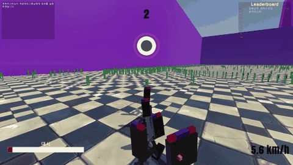
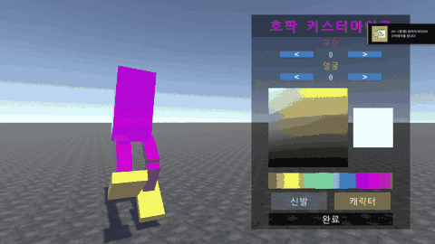
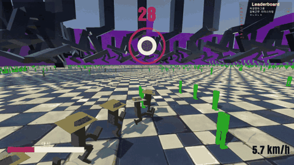
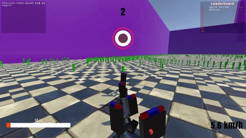
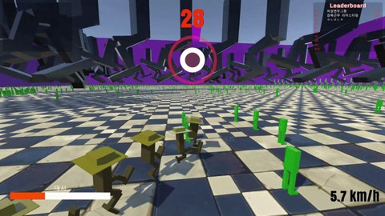

<h1 align="center">HOPAK SNAKE · 호팍 스네이크</h1>

<b>리듬 · 성장 · 멀티플레이 PvP</b>

호팍춤을 추며 시민을 모으고, 길어진 대열로 다른 플레이어와 경쟁하는 게임입니다. 리듬에 맞춰 콤보를 쌓고 대시로 상대를 추격하거나 위험한 순간을 빠져나옵니다.

## 길어질수록 커지는 경쟁

초록색 시민을 모으면 대열이 길어지고 몸집도 커집니다. 상대의 머리를 내 대열에 부딪히게 만들면 상대가 남긴 시민을 모아 더 크게 성장할 수 있습니다.

## 나만의 호팍으로 달리기

<table>
<tr><td width="50%" align="center"> <b>나만의 캐릭터</b> 색상과 장식을 골라 개성 있는 호팍을 만듭니다.</td><td width="50%" align="center"> <b>리듬을 타고 대시</b> 콤보로 채운 게이지를 추격과 회피에 사용합니다.</td></tr>
</table>

## 플레이 흐름

**캐릭터 꾸미기 → 시민 모으기 → 콤보와 대시 → 다른 플레이어와 경쟁**

| 입력 | 동작 |
| --- | --- |
| A / D 번갈아 입력 | 콤보 유지 |
| 마우스 좌우 이동 | 방향 전환 |
| 마우스 왼쪽 버튼 유지 | 대시 |
| 사망 후 Space | 로비로 돌아가기 |

플레이 스크린샷

<table>
<tr><td width="50%" align="center"> <b>시민 모으기</b> 작은 호팍에서 시작하는 성장</td><td width="50%" align="center"> <b>커지는 대열</b> 길어진 대열 사이를 달리는 경쟁</td></tr>
</table>

크래프톤 정글 게임랩 6기 · 1주차 확장 개인과제
