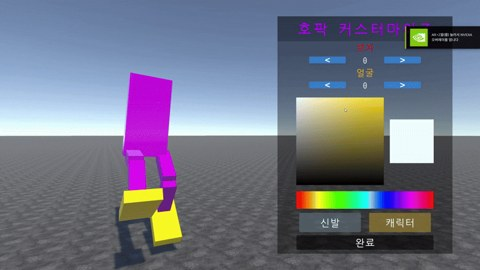

# HOPAK SNAKE · 호팍 스네이크

**호팍춤을 추며 시민을 모으고, 길어진 대열로 다른 플레이어와 경쟁하는 멀티플레이 게임입니다.**

A / D를 번갈아 누르는 리듬에 지렁이 게임의 성장과 경쟁을 더했습니다. 시민을 모아 대열을 키우고, 콤보로 충전한 대시를 추격과 회피에 사용합니다.

## 플레이 방법

1. 캐릭터의 외형과 닉네임을 정합니다.
2. 초록색 시민을 모아 대열을 늘리고 몸집을 키웁니다.
3. A / D 콤보를 유지하며 대시 게이지를 채웁니다.
4. 상대의 머리를 내 대열에 부딪히게 만들고, 상대가 남긴 시민을 모읍니다.

## 게임의 재미

- **리듬과 대시:** 리듬을 유지해 얻은 대시를 언제 쓸지 판단합니다.
- **성장과 경쟁:** 길어진 대열로 상대의 길을 막거나, 작은 틈을 찾아 빠져나옵니다.
- **캐릭터 꾸미기:** 색상과 장식을 골라 나만의 호팍 캐릭터를 만듭니다.

## 조작

| 입력 | 동작 |
| --- | --- |
| A / D 번갈아 입력 | 콤보 유지 |
| 마우스 좌우 이동 | 방향 전환 |
| 마우스 왼쪽 버튼 유지 | 대시 |
| 사망 후 Space | 로비로 돌아가기 |

크래프톤 정글 게임랩 6기 · 1주차 확장 개인과제
